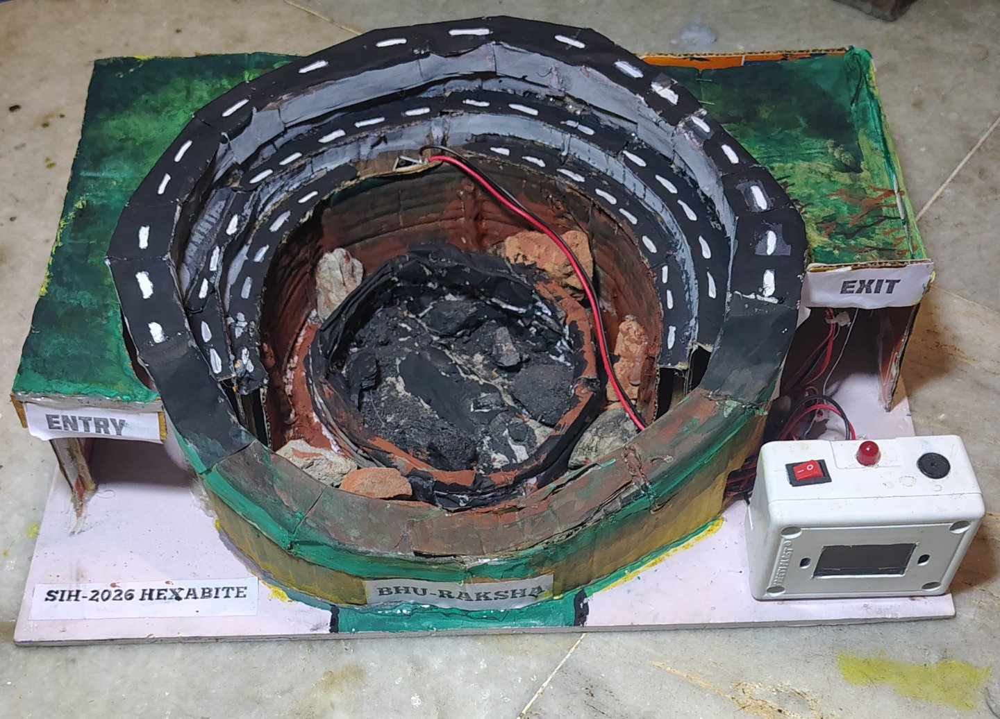
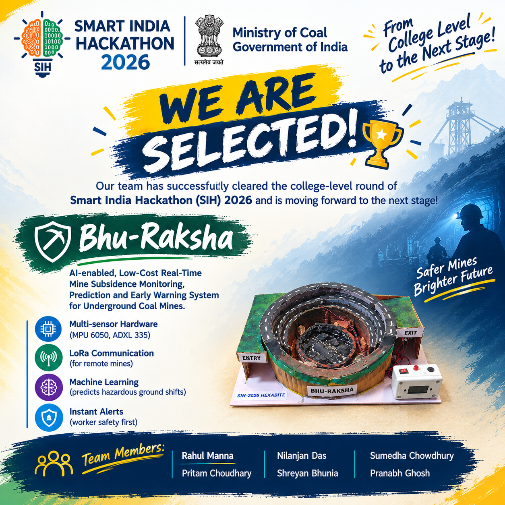

# 🌍 Bhumi Rakshha

**Low-cost smart sensor node for real-time surface subsidence monitoring above underground coal mines** ⛏️

🏆 Smart India Hackathon (SIH) · Problem Statement 25 · Team **Hexabyte**

<table align="center">
  <tr>
    <td align="center">
      
    </td>
    <td align="center">
      
    </td>
    <td align="center">
      <a href="https://youtu.be/QmVXMz43WLY">
        
      </a>
      <br>
      <a href="https://youtu.be/QmVXMz43WLY">▶️ <b>Demo Video</b></a>
    </td>
  </tr>
</table>

---

## 🎯 Problem Statement 25

Surface subsidence caused by underground coal mining puts nearby communities, public infrastructure, farmland, forests and the environment at risk. In India, subsidence monitoring still depends mostly on field observations, periodic surveys and damage assessments done after the event, so there is often no timely warning before the ground fails.

The problem asks for an **indigenous, low-cost, real-time monitoring solution** that detects early signs of ground movement and enables proactive risk mitigation, and that can be deployed across Indian underground coal mines.

<details>
<summary><b>📄 Read the full problem statement</b></summary>

<br>

**Background:** Surface subsidence caused by underground coal mining poses significant risks to nearby communities, public infrastructure, agricultural land, forest areas, and the surrounding environment. In India, subsidence monitoring is still largely dependent on conventional field observations, periodic surveys, and post facto damage assessments, which often fail to provide timely warning before critical ground failure occurs. There is a strong need for an indigenous, low cost, intelligent, and real time monitoring solution capable of detecting early signs of ground movement and enabling proactive risk mitigation.

**Description:** The problem envisages an AI-enabled smart mine subsidence monitoring and early warning platform based on a localized wireless surface mesh sensor network deployed above underground mine panels. A distributed network of low-cost smart sensor nodes is installed across the surface. Each node may carry tilt/inclination sensors, vibration sensors, displacement/stretch sensors, crack detection sensors and optional low-cost positioning modules. Nodes communicate through a wireless mesh network (LoRa / Zigbee / Wi-Fi mesh) for continuous monitoring of micro ground movements.

The system should detect abnormal ground tilt, change in relative distance between nodes, early crack initiation and unusual vibration signatures. Using AI/ML, the platform should identify abnormal deformation patterns, predict possible subsidence zones, estimate severity and progression, generate automated early-warning alerts, and support timely operational decisions.

**Expected solution:** A web/mobile-enabled platform integrating IoT, wireless mesh networking, AI and GIS for:
- low-cost smart sensor nodes on readily available hardware (Arduino / ESP32 / Raspberry Pi)
- a localized wireless mesh network over underground mine panels
- real-time monitoring of tilt, displacement, vibration and crack initiation
- AI/ML-based anomaly detection and subsidence prediction on live and historical data
- GIS-based live deformation maps and risk zones
- automated alerts through SMS / email / mobile app
- interactive dashboards for mine operators, planners and regulators
- offline capability with periodic cloud synchronization
- scalable deployment across multiple underground coalfields

The solution must be low cost, easy to deploy, energy efficient, scalable and student-prototype friendly, enabling a Made in India smart mining safety solution.

</details>

## 💡 Our Idea

**A wireless surface mesh network for real-time subsidence detection.** 🛰️

Many cheap nodes are placed over an underground mine panel. Each node watches the ground under it and talks to its neighbours, so ground movement can be tracked across the whole panel instead of at a single point. This repository holds the **working sensor node**, the building block of that network.

### Node built so far ✅

Bhumi Rakshha node runs on an ESP32 and raises an alert only after a reading is **confirmed**, so small bumps do not cause false alarms.

| | What it watches | Sensor | Alert condition |
|---|---|---|---|
| 📳 | Ground vibration | SW-180P | 3 or more pulses within 500 ms |
| 📐 | Ground tilt | Tilt switch | Tilted continuously for 1.5 s |
| 🎯 | Sudden ground movement | MPU6050 | Change in acceleration above 0.5 g |
| 💧 | Soil saturation | Soil moisture sensor | 70% or more for 5 s |

Water saturation is included because heavy rain and waterlogged soil can speed up ground failure over mined-out areas.

### How the prototype maps to the problem statement

| Requirement | Status |
|---|---|
| Low-cost node on ESP32 | ✅ Done |
| Tilt and vibration sensing | ✅ Done |
| Detecting sudden ground movement | ✅ Done (MPU6050) |
| Real-time dashboard | ✅ Done (hosted by the ESP32 on local WiFi) |
| Local alerts (buzzer, LED, OLED) and Bluetooth alerts | ✅ Done |
| Data logging to the cloud | ✅ Done (Google Sheets every 10 s) |
| Works without internet for alerts | ✅ Done |
| Displacement and crack sensors | 🔜 Planned |
| Wireless mesh between nodes (LoRa / ESP-NOW) | 🔜 Planned |
| AI/ML anomaly detection and prediction | 🔜 Planned |
| GIS risk map | 🔜 Planned |
| SMS / email / mobile app alerts | 🔜 Planned |

## 🚨 When an alert fires

- 🔔 Buzzer beeps and the LED turns on
- 📟 OLED shows a blinking alert with the action to take
- 📱 Message goes out over Bluetooth and Serial
- 🖥️ Live web dashboard shows a red alert banner
- ☁️ Sensor data is logged to Google Sheets every 10 s

## 🔧 Hardware

| Part | ESP32 pin |
|------|-----------|
| 📳 SW-180P vibration sensor | GPIO 32 |
| 📐 Tilt switch (LOW = tilted) | GPIO 5 |
| 💧 Soil moisture sensor (analog) | GPIO 34 |
| 🔔 Buzzer | GPIO 13 |
| 💡 LED | GPIO 2 (onboard) |
| 🎯 MPU6050 + 📟 1.3" SH1106 OLED (I2C) | SDA 21, SCL 22 |

⚠️ Use the original ESP32. Bluetooth Classic does not work on S2, S3 or C3 boards.

## ⚙️ How it works

- **📳 Vibration:** pulses are counted by an interrupt, so a single tap is ignored.
- **📐 Tilt:** must stay tilted for 1.5 s. A "level again" message is sent when it recovers.
- **🎯 Sudden movement:** MPU6050 is read every 100 ms with a low-pass filter. Keep the device still while it boots, because the gyro is calibrated at startup.
- **💧 Soil moisture:** 10 readings are averaged and converted to a percentage. The alert resets only after moisture drops below 65%.
- **☁️ Cloud logging:** runs in a separate FreeRTOS task, so uploads never slow down the sensors.

## 🚀 Setup

1. Install the Arduino IDE and the **esp32 by Espressif Systems** board package. Select **ESP32 Dev Module**.
2. Install the libraries `MPU6050_tockn` and `U8g2` from the Library Manager.
3. Edit these values in the sketch:
   ```cpp
   const char* ssid     = "YOUR_WIFI_NAME";
   const char* password = "YOUR_WIFI_PASSWORD";
   const char* SHEETS_URL = "YOUR_APPS_SCRIPT_URL";
   const char* SHEETS_KEY = "YOUR_SECRET_KEY";
   ```
4. Calibrate the soil sensor: print `soilRaw` in dry air and in water, then set `SOIL_DRY_RAW` and `SOIL_WET_RAW`.
5. Upload and open the Serial Monitor at 115200 baud.

🔐 Do not commit your real WiFi password, Apps Script URL or key to GitHub.

## 📱 Usage

**🖥️ Web dashboard:** connect to the same WiFi and open `http://<ESP32-IP>/` (the IP is printed on Serial). It shows live sensor status, accelerometer values, soil moisture and the latest alert.

**📲 Bluetooth:** pair with `Alert_System` and use a Bluetooth serial terminal app. Type `help` to see all commands.

| Command | Action |
|---------|--------|
| `status` | System status (also shown on OLED) |
| `mpu` | Accelerometer and gyro values |
| `soil` | Soil moisture reading |
| `time` | Current IST time |
| `reset` | Clear alerts and stop the buzzer |

## ⚠️ Limitations

- Prototype only. Thresholds need calibration on a real site.
- This is a single node. The mesh network, displacement and crack sensing, AI/ML and GIS are still to be built.
- WiFi is connected only at boot.

## 🔮 Roadmap

1. 📡 Connect many nodes with a wireless mesh (LoRa or ESP-NOW)
2. 📏 Add displacement / stretch and crack sensors
3. 🧠 Train an ML model for anomaly detection and subsidence prediction
4. 🗺️ Show live deformation and risk zones on a GIS map
5. 📩 Send SMS / email / app alerts to operators and regulators
6. ☀️ Solar power and deep-sleep for long field life

## 👥 Team Hexabyte

- Rahul Manna

## 📄 License

This project is licensed under the **MIT License**. See the [LICENSE](LICENSE) file for details.

---

<p align="center"><b>Detect early. Alert fast. Protect the land.</b> 🌍</p>
